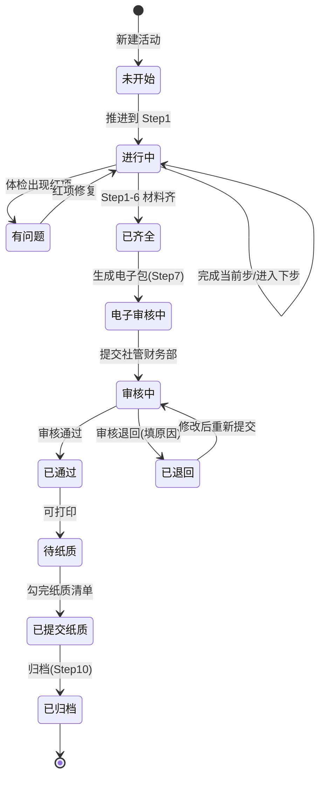
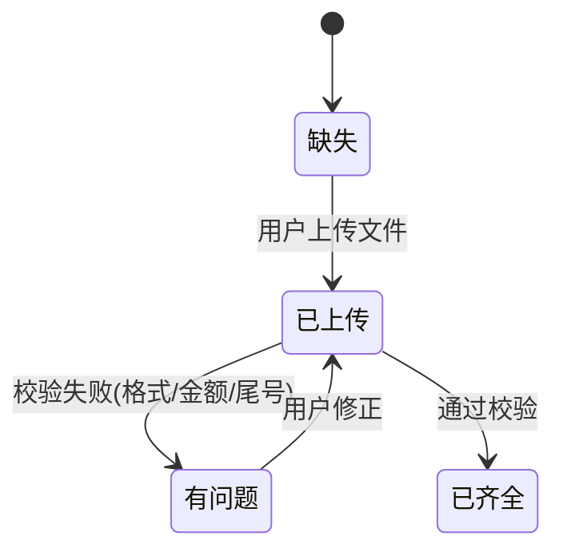

# PLAN.md — 分批开发计划 / 状态流转 / Git 节点

> 原则：每批结束可独立运行、可独立 Git 提交。每批完成后回头更新 SPEC/UI_TREE 里变化的部分。

## 1. 总状态流转图

### 1.1 活动主状态

### 1.2 单个材料项（发票/凭证/领取表）状态

---

## 2. 分批开发计划

### Batch 0 — 骨架跑通（半天）
**目标**：`npm run tauri dev` 能弹出一个窗口，三栏布局就位，DB 可读写。

- [ ] 初始化 Tauri 2 + Vue3 + Vite + TailwindCSS 项目
- [ ] Vue Router 配 6 个空页面（hash 模式）
- [ ] 三栏静态布局（左 220 / 中 flex / 右 320）
- [ ] 色板 CSS 变量按 SPEC §5 落地
- [ ] `tauri-plugin-sql` 接入 SQLite，启动时自动建表（按 SPEC §6）
- [ ] settings 表首次启动插入默认行（initial_balance=0，不弹引导）
- [ ] C# Rust 端暴露最小命令：`pick_file` / `pick_folder` / `copy_file` / `md5`

**验收**：
- 改 `src/App.vue` 里一个文字，dev 模式热更新能看到变化。
- 设置页改完社团名，重启 app 还在。

**Git 节点**：`feat: batch0 - Tauri+Vue3+Tailwind+SQLite 骨架`

---

### Batch 1 — 活动流水线 P1 核心（2~3 天）
**目标**：能新建活动、走完 Step1~6、右侧体检面板能报红/黄/绿。

- [ ] JSON Store 实现 activities / purchaseItems / invoices / vouchers / receipts / nonCard 的 CRUD
- [ ] Rust 端暴露命令：`pick_file` / `pick_folder` / `copy_file(src,dst)` / `rename_file` / `md5(path)`
- [ ] 活动列表页（新建/进入/删除）
- [ ] 流水线步骤条（10 圆点，状态色）
- [ ] Step1~6 表单与拖拽上传（按 SPEC §2 校验规则）
- [ ] 体检面板实时计算（按 SPEC §7 异常表）
- [ ] 一键修复命名（仅重命名活动目录内文件，不复制）

**验收**：
- 新建一个活动，上传一张 png，应被拒绝并提示。
- 上传一张 jpg 发票，金额填 0，体检面板出红。
- 验收单填 2×3=5，应红；改成 6 应变绿。

**Git 节点**：`feat: batch1 - 活动流水线 Step1-6 与体检面板`

---

### Batch 2 — 生成报账包 + 审核 + 纸质 + 归档（1~2 天）
**目标**：能一键生成规范文件夹树，走完 Step7~10。

- [ ] Step7：生成电子包（按 SPEC §4 文件夹树与命名规则）
- [ ] 同名冲突处理（覆盖/时间戳/取消）
- [ ] Step8：电子审核状态机（退回原因必填）
- [ ] Step9：纸质清单打印 + 勾选
- [ ] Step10：归档，actualCost 回写，活动移到历史
- [ ] 删除活动不删文件

**验收**：
- 选一个临时输出目录，生成的文件夹名严格符合 `<社团>打给<老师><金额>元`。
- 发票文件名为 `<物品>+<金额>.jpg`。
- 红项未清零时点"生成"应弹窗阻断。

**Git 节点**：`feat: batch2 - 生成报账包/审核/纸质/归档闭环`

---

### Batch 3 — 工作台 + 总账 + 图表（1 天，P2）
- [ ] 余额/本月支出/待报销三张卡片
- [ ] 待办列表
- [ ] ECharts 饼图 + 柱状图（本地 vendor 拷贝）
- [ ] 余额 <50 元红光闪烁彩蛋
- [ ] 总账表格 + 导出 CSV
- [ ] 报销跟踪看板（简化为按钮切状态）

**Git 节点**：`feat: batch3 - 工作台/总账/图表`

---

### Batch 4 — 设置 + 模板库 + 打包（半天，P3）
- [ ] 设置页表单
- [ ] 模板库：内置**领取表**和**非公务卡审批表**两份 docx（用户提供）；**验收单**和**采购清单**由 AI 生成空白 docx 顶上
- [ ] 备份/恢复 app.db（导出/导入）
- [ ] `npm run tauri build` 产物验证
- [ ] 写一份《如何用》一页纸（给未来的自己）

**Git 节点**：`feat: batch4 - 设置/模板/打包发布`

---

## 3. Git 提交流程（遵守用户全局规则）

1. AI 每次准备 commit 前，先向用户报告：
   - 改动文件清单（`git status`）
   - 本次提交摘要（一句话）
   - 拟用 commit message
2. 用户回复"同意"后才执行 `git add` + `git commit`。
3. 不 push 远程。
4. 初始仓库初始化放在 Batch 0 结束后第一次提交时一并做。

---

## 4. 风险与回退

| 风险 | 应对 |
|---|---|
| WebView2 Runtime 未装 | 打包时勾选 MSI 引导安装；README 写明 |
| Rust 工具链首次编译慢 | 第一次 `tauri build` 可能要 5~10 分钟，属正常 |
| SQLite 文件损坏 | SPEC §7 已规定启动备份为 `app.db.bad.<时间戳>` |
| 路径含中文/空格 | Rust `std::path::Path` 处理；生成包前校验 |
| 图片很大（>10MB） | 前端上传时压缩到长边 1600px（P1 可不做，P3 补） |
| 用户改需求 | 先改 SPEC/UI_TREE，再改代码；不要跳过文档直接改代码 |

---

## 5. 已确认事项与剩余开放项

**已按用户要求定稿**：
- ✅ 技术栈：Tauri 2 + Vue3 + Vite + TailwindCSS + SQLite
- ✅ 首次启动**不弹**初始余额/预算引导；`initial_balance` 默认 0，后续在设置里改
- ✅ 活动预算 `budget` 字段保留，但**不强制必填**
- ✅ 模板库三份模板（用户已拷到项目根目录）：
  - `"非公务卡"结算特殊情况审批表模板.docx`
  - `低值易耗品"验收单"模板.docx`
  - `领取表模板.xlsx`（注意是 xlsx 不是 docx，P3 直接拷贝原文件，不转格式）
  - 采购清单无现成模板，Batch 4 由 AI 生成空白 docx

**开发机环境实测（2026-09-18）**：
- ✅ Node.js v22.23.2 / npm 10.9.8
- ✅ WebView2 Runtime 153.x
- ❌ Rust 工具链未安装 → Batch 0 第一步装
- ❌ VS Build Tools（MSVC link.exe）未安装 → Batch 0 必须装，否则 Tauri 编译失败
